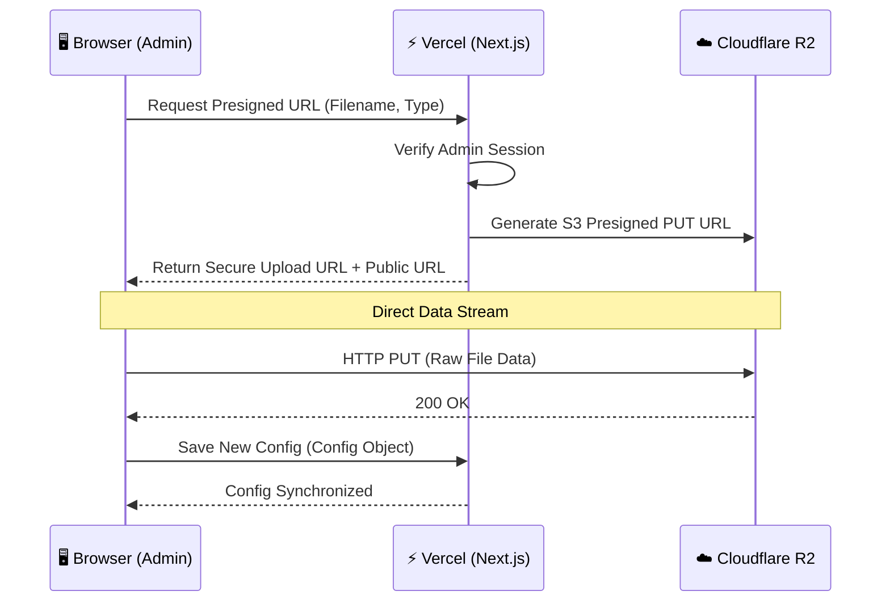

# ☁️  Cloudflare R2 Asset Management System

This document outlines the high-performance asset storage architecture implemented for **avrxt.dev**, migrating from Supabase Storage to Cloudflare R2 for better latency, cost-efficiency, and edge delivery.

---

## 🏗️ Architecture Overview

The system uses a **Hybrid Edge-Auth Flow**. Authentication is handled on the server, while the actual data transfer happens directly between the Client and Cloudflare's Edge, bypassing Vercel's serverless function limitations.



---

## 🚀 Key Features

### 1. Direct-to-Cloud Uploads
The admin requests a short-lived S3 presigned PUT URL after server-side admin authorization and file type/size checks. The browser sends the file directly to R2, avoiding application-server request-body limits. Images can be up to 10 MB, audio 25 MB, and video 100 MB. A server-side HEAD check verifies stored size and content type before the UI accepts the new URL.

Every upload is renamed `avrxt-<UUID>.<MIME-derived-extension>`; original personal filenames and misleading extensions are discarded. The signing client uses `requestChecksumCalculation: WHEN_REQUIRED`, avoiding the SDK's checksum of an empty body when presigning a future browser upload. Content-Type is explicitly signed and sent consistently.

### 2. Intelligent Folder Hierarchy
Assets are automatically routed to global edge CDN paths:
- **Images**: `/i/` mapped to `cdn.avrxt.dev`
- **Videos/Audio**: `/v/` mapped to `cdn.avrxt.dev`

### 3. Safe Asset Replacement
When a user replaces or removes an asset in `/me/admin`, the old object stays available until the updated profile config is saved. After the save succeeds, the admin attempts to delete unreferenced R2 objects. Failed cleanup remains queued and can be retried by saving again.

### 4. Gallery Removal
Removing a gallery item edits the pending profile draft. The R2 object is deleted only after that draft is saved successfully.

### 5. Segmented gallery video (HLS)
Gallery entries whose URL ends in `.m3u8` use HLS playback. The page loads the HLS player and requests the playlist/segments only after a visitor presses Play; existing MP4 uploads remain supported as a compatibility fallback. Build and upload a stream from a trusted workstation with `ffmpeg` and the R2 server credentials exported in its environment:

```bash
npm run media:hls -- /absolute/path/to/video.mp4
```

The script prints an immutable R2 manifest URL such as `https://cdn.avrxt.dev/v/hls-<uuid>/index.m3u8`. Paste that URL into the matching gallery video’s URL field in `/me/admin`, then save. The generated four-second segments are delivered directly from `cdn.avrxt.dev`, never through Vercel. Removing that gallery entry removes its generated HLS prefix after the configuration save. The R2 credential used for cleanup needs `s3:ListBucket` in addition to object read/write/delete permissions.

---

## 🛠️ Technical Fixes & Optimizations

### 🛂 CORS Configuration
To allow the browser to talk to Cloudflare, the following CORS policy is applied:
- **Allowed Origins**: `https://avrxt.dev`, `https://www.avrxt.dev`, `https://staging.avrxt.dev`, `http://localhost:3000`, `http://localhost:3007`
- Apply `cloudflare/r2-cors.json` once through Cloudflare bucket settings. Upload requests do not inspect or change bucket CORS; the application's object-scoped credential does not need GetBucketCors/PutBucketCors privileges. This prevents failed management checks or concurrent policy changes from interfering with uploads. The server checks the explicit upload-origin allowlist before signing.
- Additional preview/local origins must be explicitly included in `R2_UPLOAD_ORIGINS` and the bucket CORS configuration. Do not allow arbitrary origins supplied by visitors.
- **Allowed Methods**: `GET, HEAD, PUT`
- **Allowed Headers**: `Content-Type` (the browser upload signs and sends this header)

The active bucket is `avrxt-core`, with `cdn.avrxt.dev` attached. The Wrangler API format is provided separately from the S3 policy:

```bash
npx wrangler r2 bucket cors set avrxt-core --file cloudflare/r2-cors.wrangler.json
npx wrangler r2 bucket cors list avrxt-core
```

The existing `r2-cors.json` uses S3 field names; it is not a valid input to Wrangler's CORS command. The live policy was applied on 12 October 2026 and verified with a temporary image upload, CDN byte comparison and Origin response header. The test object was deleted. Existing objects and their stored URLs were retained.

### ⚡ Performance Tuning
- **Region**: `auto` (Routes to the nearest Cloudflare data center).
- **TTL**: Presigned URLs are valid for **600 seconds** (10 minutes).
- **MIME**: The browser sends the file MIME type used when requesting the URL; unsupported or missing types are rejected by the server.
- **Storage credentials**: `R2_ENDPOINT`, `R2_ACCESS_KEY_ID`, `R2_SECRET_ACCESS_KEY`, and `R2_BUCKET_NAME` are server-only secrets. Configure the public CDN host variables separately.
- **Endpoint**: Use the HTTPS S3 endpoint ending in `.r2.cloudflarestorage.com`, without a bucket path. A public CDN URL cannot sign S3 requests.
- **Troubleshooting**: Distinguish timeout, network/CORS, HTTP rejection (including a safe R2 error code), and server verification failure. Never log the signed URL. A live test must use the deployed application's actual origin and credentials.
- **Recovery**: After a failed PUT, the server checks the existing object before the browser retries. If it already matches the approved size and MIME type, the upload succeeds without resending. Transient failures permit one retry with a fresh signed URL for the same key; signature/permission rejections do not blindly retry. A brief HEAD failure after a successful PUT retries verification once, without reuploading. Large files above 25 MB have a ten-minute transfer timeout; smaller files have three minutes. The URL remains valid for ten minutes and is renewed for a retry. Retries cannot create a second asset key.

---

## ⚙️ Environment Configuration

| Variable | Usage |
|--- |--- |
| `R2_ENDPOINT` | Cloudflare R2 S3 API Endpoint |
| `R2_ACCESS_KEY_ID` | API Access Key |
| `R2_SECRET_ACCESS_KEY` | API Secret Key |
| `R2_BUCKET_NAME` | `avrxt-core` |
| `NEXT_PUBLIC_R2_DOMAIN` | `https://cdn.avrxt.dev` |
| `NEXT_PUBLIC_R2_IMAGE_DOMAIN` | `https://cdn.avrxt.dev` |
| `NEXT_PUBLIC_R2_VIDEO_DOMAIN` | `https://cdn.avrxt.dev` |

---

*14 October 2026: regression tests cover recovery, same-key renewal, bounded retries, origin policy and MIME/size validation. Live preflight requests accepted Production, staging and localhost:3007, and rejected an unrelated origin. A full signed-upload browser smoke test is still required after deploying this correction.*
